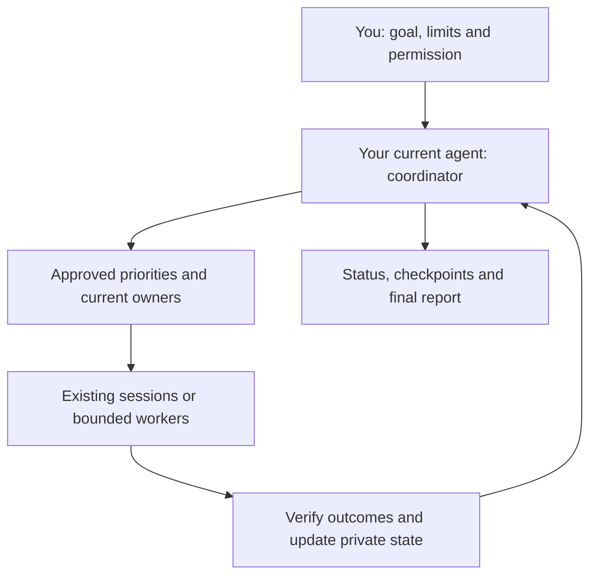

# Codex Top Mode

**Turn available AI capacity into finished work, with one coordinator and a clear stopping time.**

Your existing agent checks pending work, priorities, owners and permissions,
then uses suitable available models and reports verified outcomes. Quality comes first.

This package contains a skill and small Python helpers. Downloading it starts
no work, creates no schedule and changes no global agent settings. [MIT license](LICENSE).

## Start in three steps

1. **Give your agent this README URL or the local package folder**, then paste:

   ```text
   Read this README and the linked AGENTS.md and SKILL.md explicitly.
   Tell me what you actually loaded and can do on this host.
   Prepare my private setup: projects and exclusions, priorities, current owners,
   useful finish criteria, allowed actions, available models and a time limit.
   Explain it in my language. Wait for my approval before starting work.
   ```

2. **Approve the setup:** projects, actions and limits. The agent prepares private
   files; you need not edit JSON. Disabled fictional examples grant no permission.
3. **Start a manual session**, after approving that setup. For example:

   ```text
   Start manual Top Mode for 30 minutes on the approved pending documentation
   tasks. Keep existing owners and stay within my approved actions and limits.
   Show progress at checkpoints, then stop new assignments and give me a report.
   ```

Manual mode needs **no announcement and no reset**. Quota means your usage
allowance. Without native quota tools, use supervised work with a clock deadline;
automatic weekly stopping is unavailable. A URL installs nothing: the agent
must read the linked files. See [AGENTS.md](AGENTS.md).

## One place to coordinate

Your current agent coordinates priorities and owners, continues permitted existing
sessions, verifies results and updates private state. Use subagents only for useful
independent work when supported; otherwise work serially. These are instructions
for your agent, not an executor or automatic model router.



Choose economical models for easily verified work and stronger ones for ambiguity
or failed checks, within client capabilities. Verify completion; chat badges and
archive state are not evidence. No dashboard, Cloud/Work account or new service is needed.

## What is available, and what is active?

| Feature | What it does | When it operates |
| --- | --- | --- |
| Manual Top Mode | Bounded work on approved tasks. | Your explicit start. |
| Public announcement watch | Finds new verified visible posts. | Separate permission, configuration and tested host scheduling/notification; typically every four hours. |
| Conditional start | Checks verified upcoming news, ready work and fresh native quota. | Prior conditional permission. Applied or ambiguous news stays advisory. |
| Saved reset reminders | Advises about available credits nearing actual expiry. | Fresh native credit details; recurrence needs a requested, tested host schedule. |
| Maintainer review | Reviews package changes. | Optional, separately configured. No Claude credential is needed to use Top Mode. |

A saved (banked) reset is a credit to replenish usage allowance, not money.
Watching announcements and checking saved credits are separate. News grants no
permission. Reset redemption always needs your current confirmation and an eligible
supported action.

Ask **“Show setup and status: what is loaded, configured, running and scheduled?”**
Expect separate answers for files present, instructions read, approved setup,
active work/deadline and tested schedules/notifications. A saved receipt cannot
wake an agent by itself.

## Check, pause and finish

These are requests to your agent, not installed shell commands:

| Say | Expect |
| --- | --- |
| “Show status.” | Active mode/deadline, task owners, verified progress, blockers and latest available quota. |
| “Give me a checkpoint.” | What is saved, what remains and who can resume each task. |
| “Stop Top Mode.” | No new assignments; bounded checkpoints from active owners and a private closing report. |
| “Explain the final report.” | Before / after / pending / next step by project, with sourced metrics and explicit unknowns. |

New assignments stop at the fixed deadline, on revoked authority or the applicable
native-quota stop. News and credits cannot extend it. Closing the host interrupts
observation; resuming requires fresh checks. Saved work and owners are preserved.
Stopping Top Mode ends intensive follow-up. Ask separately to pause the public
announcement watch or saved-reset reminders; confirm which host schedules paused.

**Fictional example:**

> You: “Use the approved 30-minute session to finish the recovery instructions.”
>
> Coordinator: “The existing documentation owner is available. I’ll continue that
> work, verify the steps and checkpoint the result. This fictional setup reserves
> publication for your approval.”
>
> Report: “Before: recovery steps were missing. After: documented and reproduced
> in a sample. Pending: publication. Next: documentation owner requests approval.
> Elapsed: 12 of 30 minutes; quota and tokens unknown on this host.”

See the [report contract](references/profile-contract.md#run-report). Account-wide
quota changes do not measure task cost or savings.

## Limits and further reading

- Python 3.11+; no third-party runtime dependencies. The public watcher supports
  macOS/Linux file locking and fails closed on Windows.
- Automation depends on a reachable host and its tested scheduler, notifications,
  delegation and quota capabilities. The helpers run only when called.
- Public X discovery is partial. Failed or uncertain reads mean unknown coverage.
  The script makes no model calls; a scheduler waking a model can still consume quota.
- Profiles and reports stay private. Project permissions, review, merge and
  sensitive actions retain their separate approval rules. Markdown instructions
  guide an agent; they are not a sandbox or a universal security guarantee.

**For agents:** [AGENTS.md](AGENTS.md) → [SKILL.md](SKILL.md) →
[profile, watch commands and state contract](references/profile-contract.md).

**For contributors:** [maintenance and review guide](references/maintaining.md).
User-visible changes are in the [changelog](CHANGELOG.md).
